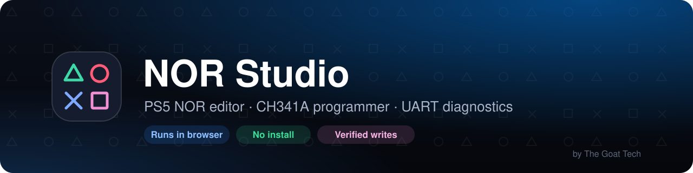
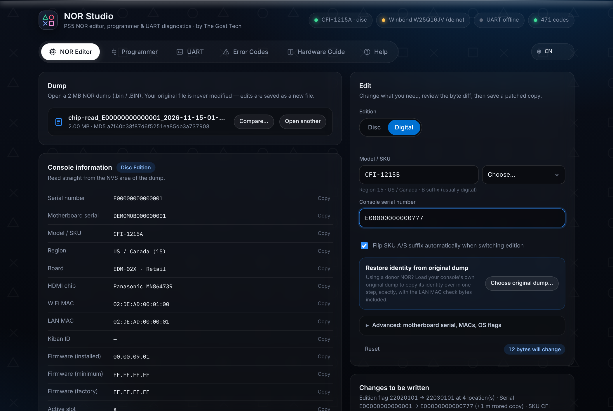
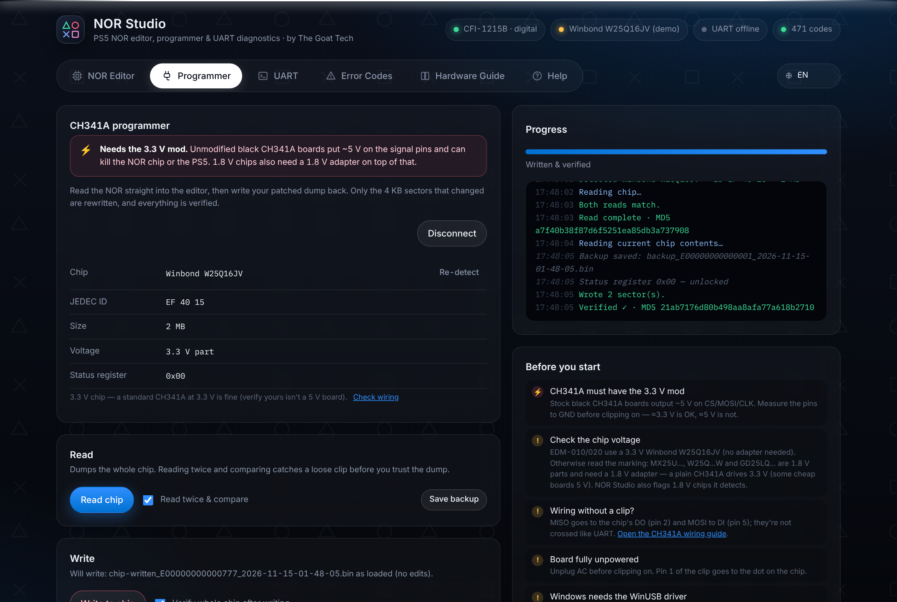
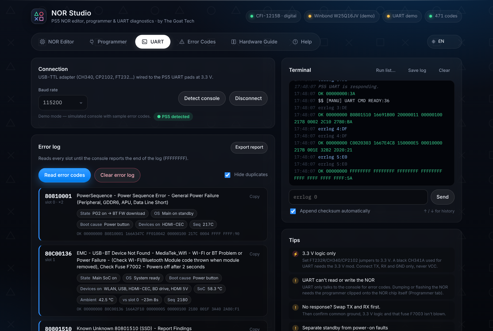
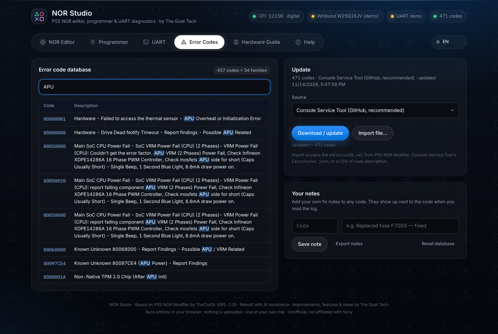
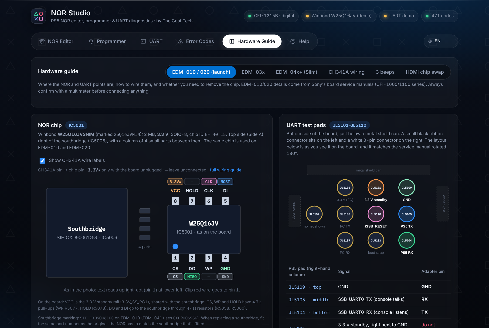
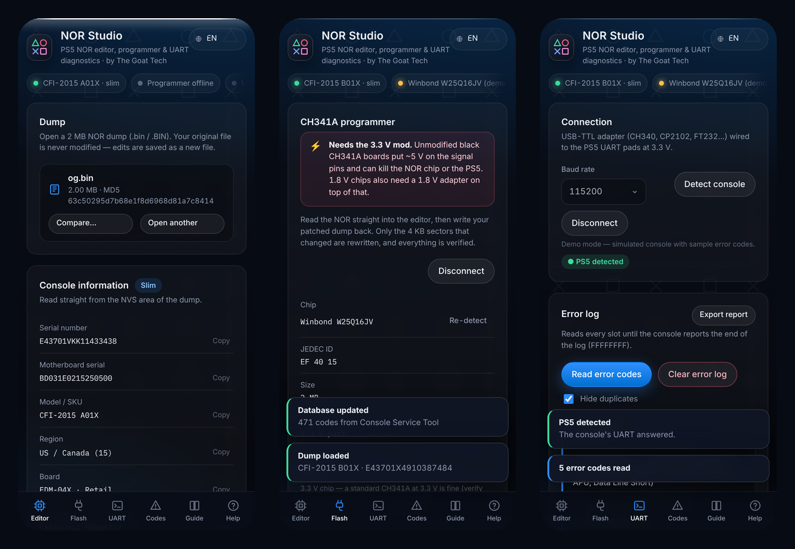
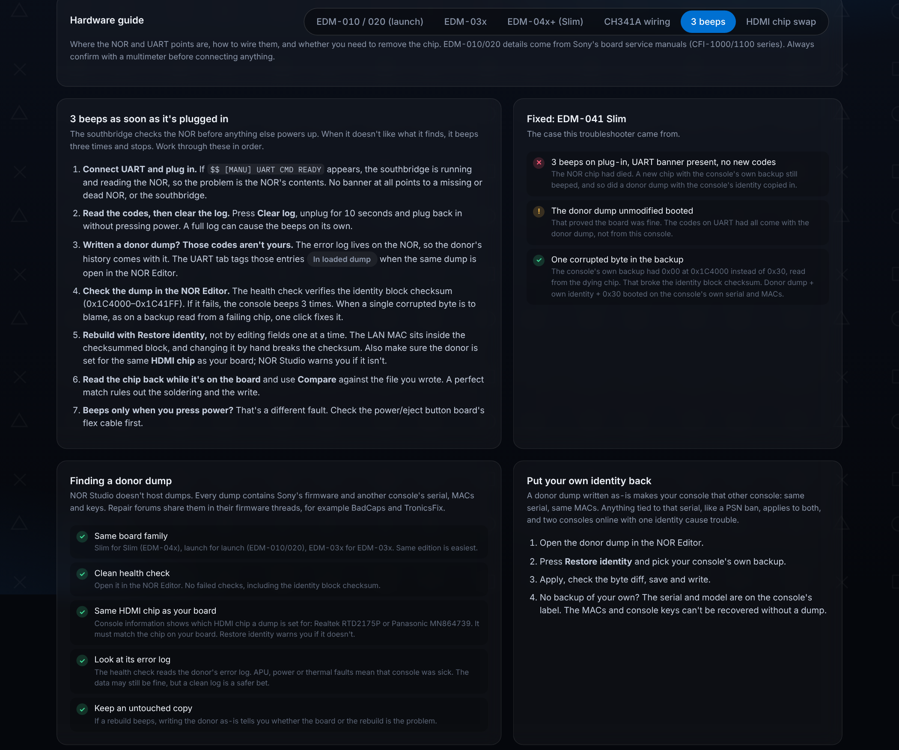
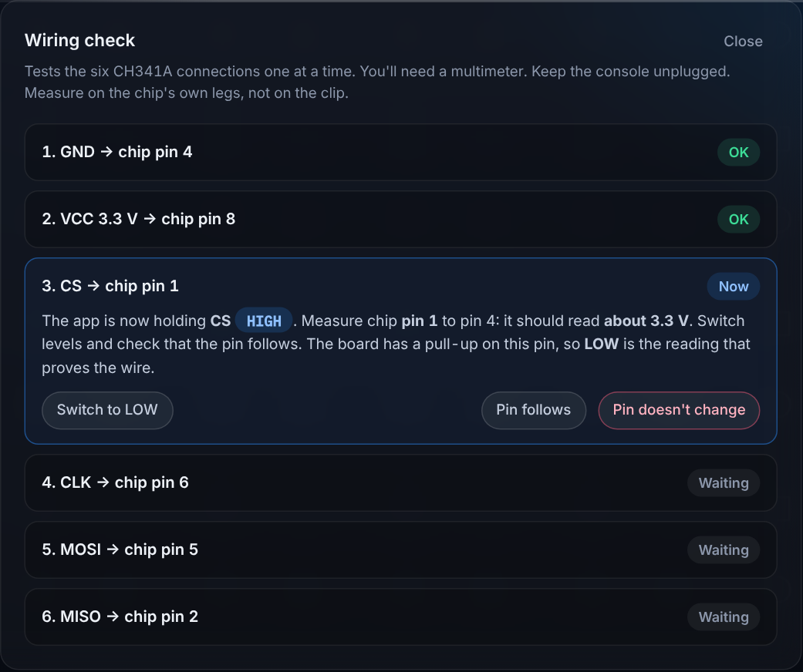

  

  
  
  
  
  

  <b>Read, repair and rewrite PS5 NOR dumps, flash them with a CH341A, and decode UART error codes, all from one page in your browser.</b>

  

---

## ✨ Highlights

| | |
|---|---|
| 🧩 **NOR Editor** | Reads serial, motherboard serial, SKU, region, board, Wi‑Fi (all 3 copies) and LAN MAC, firmware, active slot, OS flags, MD5 and SHA‑256. Switches Disc ↔ Digital and edits serial and SKU. Advanced edits cover motherboard serial, WiFi MAC and OS flags (IDU, manufacturing mode, boot messages, memory tests). **Restore identity from original dump** copies a console's own IDs onto a donor NOR in one step, including the LAN MAC check bytes. Every change gets a byte‑level diff before saving. Health check includes SLB2 firmware containers and flag‑copy consistency. |
| 🔌 **CH341A Programmer** | Reads the NOR straight into the editor (reads twice and compares), lets you read first before every write (saves a backup and rewrites only the 4 KB sectors that changed) or write without reading after a clear warning, then verifies the whole chip. Detects the chip and warns about 1.8 V parts. If the chip doesn't answer, it diagnoses the ID (stuck high, stuck low, shifted, intermittent) and a **wiring check** walks through all six connections to name the one that's broken. |
| 📟 **UART Diagnostics** | Detects the console automatically and wakes it with a serial break. Reads the whole error log and decodes each entry: description, power state, OS state, boot cause, active devices, SoC and ambient temperatures, and time between entries. Also has a terminal with auto‑checksum, a command‑list runner, log clearing and report export. |
| 📚 **Error Code Database** | 430+ exact codes plus 30+ code families (pattern matching). Downloads over HTTPS and is cached offline. Imports the old `errorDB.xml`, Console Service Tool JSON or CSV. Adds your own repair notes per code. |
| 🔔 **3 beeps troubleshooter** | Step-by-step checks for a console that beeps three times when plugged in, taken from a real EDM-041 repair, plus a checklist for vetting donor dumps (with a check of the donor's own error log) and restoring your own identity. NOR Studio doesn't host dumps. |
| 🌐 **Languages** | English, Português (Brasil), Español (Latinoamérica), Español (España), 简体中文 (Simplified Chinese) and 繁體中文 (Traditional Chinese, Taiwan). NOR Studio follows your browser's language (any Spanish locale except Spain gets Latin American Spanish), and the picker next to the tabs switches it any time. Error code descriptions from the database stay in English. |
| 🗺️ **Hardware Guide** | EDM‑010/020 NOR pinout (IC5001, W25Q16JV) and UART pad map (JL5101–JL5110) in real board orientation, EDM‑03x and EDM‑04x+ (Slim) UART pads, in‑circuit vs chip‑off guidance, and tips for Slim boards. |
| 💡 **PS5 light bar** | A thin glow along the top edge shows what the tool is doing: blue while working, a white flash on success, amber on errors. |
| 🛡️ **Safety first** | Voltage checks before connecting, 3.3 V‑mod warnings for the CH341A, write gates, serial/MAC mismatch warnings. Your original file is never modified. |

## 📸 Screenshots

<table>
  <tr>
    <td width="50%">
<b>NOR Editor</b>: console info, edits and byte diff
</td>
    <td width="50%">
<b>Programmer</b>: CH341A read, write and verify
</td>
  </tr>
  <tr>
    <td width="50%">
<b>UART</b>: error log with decoded descriptions
</td>
    <td width="50%">
<b>Error Codes</b>: searchable database with notes
</td>
  </tr>
  <tr>
    <td colspan="2">
<b>Hardware Guide</b>: NOR pinout and UART pad map for EDM‑010/020
</td>
  </tr>
  <tr>
    <td colspan="2" align="center">
<b>On a phone</b>: bottom tab bar, stacked layouts, nothing cut off
</td>
  </tr>
  <tr>
    <td colspan="2" align="center">
<b>3 beeps troubleshooter</b>: what to check, in order, when a console beeps three times on plug-in
</td>
  </tr>
  <tr>
    <td colspan="2" align="center">
<b>Wiring check</b>: finds which CH341A connection is broken when the chip reads FF FF FF
</td>
  </tr>
</table>

## 🚀 Getting started

**Use it online:** open **https://gmorb.github.io/nor-studio/** in desktop **Chrome** or **Edge**.

**Use it offline:** download [`index.html`](index.html) (or the file from the latest [release](../../releases)) and double‑click it. That's the whole app.

> Web Serial (UART) and WebUSB (CH341A) are Chromium features. Firefox and Safari can still use the NOR editor and the error code database.

### Hardware you might use

| Hardware | Used for | Notes |
|---|---|---|
| CH341A (black) | Programmer tab | **Needs the 3.3 V mod.** Stock boards put ~5 V on the signal pins. Windows: switch it to WinUSB once with [Zadig](https://zadig.akeo.ie). |
| SOIC‑8 clip | Reading the NOR in‑circuit | Pin 1 (red wire) goes to the dot on the chip |
| FT232R / CH340 / CP2102 | UART tab | Set the jumper to **3.3 V**. Wire TX, RX and GND only. |
| XGecu T76 / RT809 | Use their own software | Open the resulting `.bin` in NOR Studio to edit |

📘 **New to NOR Studio?** Read the [user manual (PDF)](docs/NOR-Studio-Manual.pdf): safety, setup, every tab, step-by-step jobs, the 3 beeps troubleshooter and a troubleshooting table.

See also the in‑app **Help** and **Hardware Guide** tabs, or [`docs/HARDWARE_GUIDE.md`](docs/HARDWARE_GUIDE.md).

## 🔧 Typical workflows

<b>Disc → Digital conversion</b>

1. **Programmer** → Connect → **Read chip** (it opens in the editor) → **Save backup**.
2. **NOR Editor** → Edition: *Digital*. The SKU suffix flips A → B automatically. Review the diff.
3. **Programmer** → **Write to chip**. Only the changed sectors are rewritten, then the whole chip is verified.

<b>Diagnose a no‑power / blue‑light console</b>

1. Wire UART (TX ↔ RX, GND), adapter at 3.3 V, AC in, console in standby.
2. **UART** → Connect → **Read error codes** → **Export report**.
3. Clear the log, power on once, then read again to separate standby faults from power‑on faults.

<b>Recover from a corrupted NOR</b>

1. Read the chip twice and keep the backup, even if it's damaged.
2. Check the health check results. Compare against a known‑good dump of the same model with **Compare…**.
3. Keep the console's own serial and MAC set. These values are paired with the hardware.

## 🛠️ What changed vs. PS5 NOR Modifier

- Fixed the **database download error**: the legacy `http://uartcodes.com/xml.php` source is replaced by an HTTPS source with clear errors and offline import.
- Fixed **board variant changes silently not being applied**: the region text was appended before the search.
- Fixed **Digital detection reading the wrong offset**.
- Fixed `.BIN` (uppercase) files being rejected.
- Fixed UART reads that could hang forever.
- Patches are confined to the NVS area (`0x1C4000–0x1D0000`) instead of a whole‑file find/replace.
- New: CH341A programmer, health check, dump compare, hashes, notes, report export, hardware guide.

## ⚠️ Disclaimer

This software is provided **as‑is, without warranty of any kind**. Modifying or flashing a NOR can permanently damage a console. **Use it at your own risk.** Always keep a backup of your original dump.

NOR Studio is an unofficial tool and is **not affiliated with or endorsed by Sony Interactive Entertainment**. PlayStation and PS5 are trademarks of Sony Interactive Entertainment. No Sony firmware, keys, dumps or service documentation are included in this repository.

## 🌐 Translations

Translations are in [`i18n/`](i18n): one JSON file per language, mapping each English string to its translation. Keys with `{name}` slots are patterns for text that contains numbers or file names; keep the slots and any HTML tags in your translation. After editing, run `python tools/build_i18n.py` to build them into `index.html`. Chinese is `i18n/zh.json` (Simplified) and `i18n/zh-TW.json` (Traditional, with Taiwan's repair terms). Latin American Spanish is `i18n/es-419.json` and Spain's is `i18n/es.json`; they share most text but differ in repair vocabulary (for example *tarjeta madre* vs *placa base*, *reporte* vs *informe*, *presiona* vs *pulsa*). To add a language, copy `i18n/es.json` to `i18n/<code>.json`, translate the values, and add the code to the language picker (see the notes at the top of `tools/build_i18n.py`). Corrections from native speakers are very welcome.

## 🙏 Credits

- Part of the code and logic comes from **[PS5 NOR Modifier](https://github.com/TheCod3rYouTube/PS5NorModifier) by TheCod3r** (GPL‑2.0): NOR offsets, edition flags, UART command format and checksum.
- Rebuilt and extended **with the help of AI assistance**.
- Improvements, extra features and ideas by **The Goat Tech**.
- NOR layout cross‑checked against [ps5‑wee‑tools](https://github.com/andy-man/ps5-wee-tools) by andy‑man.
- [Console Service Tool](https://github.com/amoamare/Console-Service-Tool) by amoamare: the error code data (loaded at runtime), the documented error‑log field meanings, OS flag layout and UART reference photos, which are linked rather than copied.
- [ps5-hdmi-tool](https://github.com/MeoWDev-MOD/ps5-hdmi-tool) by MeoWDev-MOD: documented the identity block checksum and the HDMI chip selector, which NOR Studio implements independently.

## ☕ Support the project

NOR Studio is free and built in my spare time. If it saved a console, a coffee helps cover the costs of maintaining it, such as the **hardware** for testing and confirming board revisions like the EDM‑041 NOR, and the **time** I spend on fixes and new features.

Every donation is appreciated, and the tool will always stay free. Thank you!

## 📄 License

Released under the **GNU General Public License v2.0**, the same license as the original PS5 NOR Modifier. See [LICENSE](LICENSE) and [NOTICE.md](NOTICE.md).
