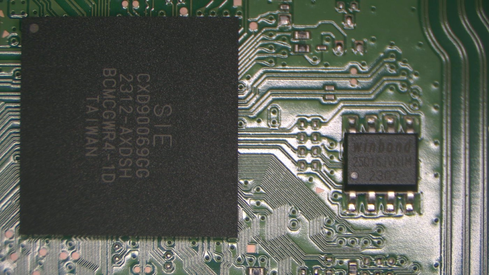
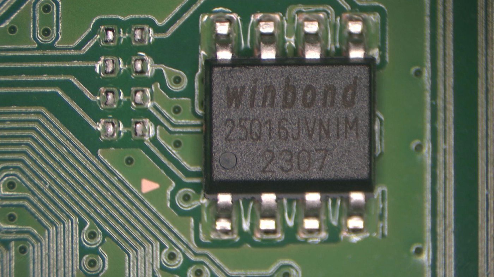

# Hardware guide

> ⚠️ Confirm every point with a multimeter before connecting anything. Wrong voltage or a swapped wire can permanently damage the console. Use at your own risk.

## Quick answer: in‑circuit or chip‑off?

| Method | When it works | Notes |
|---|---|---|
| **UART pads** | Reading and clearing error codes only | UART goes to the southbridge. It **cannot** read or write the NOR. |
| **SOIC‑8 clip, in‑circuit** | Often, on EDM‑010/020 | The clip back‑powers the 3.3 V standby rail that also feeds the southbridge. Hold `/SSB_RESET` low if reads are unstable. |
| **Lift pin 8 (VCC)** | When in‑circuit reads are unstable | Isolates the chip from the rest of the rail |
| **Chip‑off** (SOP8 adapter) | Always | The most reliable method; reflow it back in the same orientation |

Always read **twice** and compare. NOR Studio does this for you.

---

## Rebuilding from a donor NOR

Repair technicians report that a known-good donor dump from the **same board type** (same EDM revision and components) can bring back a console whose own NOR is lost or corrupted. Restoring the console's own identity afterwards keeps WiFi, controllers and the disc drive pairing happy.

- Always try the console's **own** dump first if you have one that reads cleanly twice and passes the health check.
- The LAN MAC at `0x1C4020` has **two check bytes at `0x1C403E`** that can't be recalculated. Changing the MAC without them makes the console beep 3 times. Copy the whole `0x1C4000–0x1C403F` block (board ID + LAN MAC + check) from the original dump as one unit.
- In NOR Studio: open the donor dump → Edit → **Restore identity from original dump** → choose the console's original dump → Apply → review the diff → Save.

## Wiring a CH341A straight to the chip

For soldered wires, a chip-off on a breakout, or when the clip won't fit. Every PS5 board covered here uses the same Winbond W25Q16JV, so the mapping is the same.

| CH341A label | Flash pin | Why |
|---|---|---|
| CS | **1** /CS | Chip select |
| MISO | **2** DO / SO | Data from the chip *out* to the programmer *in* |
| MOSI | **5** DI / SI | Data from the programmer *out* to the chip *in* |
| CLK | **6** CLK | Also printed SCK / SCLK |
| GND | **4** GND | Connect first |
| VCC 3.3 V | **8** VCC | **Only when the board is unplugged**; leave it off on a powered board |

**Why the names don't match:** SPI is named from the programmer's side. MISO ("master in, slave out") goes to the chip's output DO; MOSI ("master out, slave in") goes to the chip's input DI. Don't cross them like UART's TX→RX. Aliases: DO = SO = IO1 = Q · DI = SI = IO0 = D · CS = CE# = SS · CLK = SCK = SCLK. If your programmer prints DO/DI instead of MISO/MOSI, wire it one way and check the chip ID. If it reads `FF FF FF` or `00 00 00`, swap those two wires.

**/WP (pin 3) and /HOLD (pin 7):** pulled up on the board, so leave them alone in-circuit. On a chip-off, tie both to VCC.

### Two ways to power the chip

- **Recommended: board unplugged, programmer powers the chip.** Connect all six wires. If reads are unstable, ground JL5110 (/SSB_RESET) on EDM-010/020, or lift pin 8, or remove the chip. This is the only method for EDM-03x/04x.
- **Advanced: board powered in standby, programmer doesn't.** Connect CS, MISO, MOSI, CLK and GND only. **Never connect the programmer's 3.3 V wire here**: two supplies on one rail can damage the programmer, the chip or the board. In standby the southbridge also drives the SPI lines, so it **must be held in reset** (JL5110 to GND on EDM-010/020) or reads garble and writes can corrupt the NOR. Not for EDM-03x/04x until a reset point is known.

**Check with the app:** `EF 40 15` = correct. `FF FF FF` = check MISO→2 and CS→1. `00 00 00` = no power or GND, or MOSI/MISO swapped. Changing or odd IDs = loose wire or clock; shorten wires and re-solder CLK→6.

## EDM‑010 / EDM‑020 (CFI‑10xx / 11xx)

Source: Sony board service manuals for the CFI‑1000/1100 series (schematic sheets "SFlash 2MB" and "MISC", printed wiring boards side A and side B).

### NOR chip: IC5001

- **Part:** Winbond **W25Q16JVSNIM**: 16 Mbit (2 MB), **3.3 V**, SOIC‑8. JEDEC ID `EF 40 15`.
- **Location:** top side (Side A), immediately right of the southbridge **IC5006**.
- **Supply:** `3.3V_SS_PG1` (the southbridge's standby rail).

| Pin | Name | Connection |
|---|---|---|
| 1 | /CS | `/S50_SSB_SF_CS`, 4.7 kΩ pull‑up (R5074) |
| 2 | DO (MISO) | 47 Ω (R5058) → `S50_SSB_SF_SIO1` |
| 3 | /WP | 4.7 kΩ pull‑up to 3.3 V (R5077) |
| 4 | GND | GND |
| 5 | DI (MOSI) | 47 Ω (R5060) → `S50_SSB_SF_SIO0` |
| 6 | CLK | `S50G_SSB_SF_SCLK` |
| 7 | /HOLD | 4.7 kΩ pull‑up to 3.3 V (R5078) |
| 8 | VCC | `3.3V_SS_PG1` |

This is a 3.3 V chip, so no 1.8 V adapter is needed. The CH341A must still have the **3.3 V mod**.

### UART / service test pads: JL5101–JL5110

Bottom side of the board, just below a metal shield can. A small black ribbon connector sits on the left and a white 3‑pin connector on the right.

As seen on the board (this is the service manual drawing rotated 180°):

```
          [ metal shield can ]
         JL5106   JL5101   JL5109      ← 3.3V FC · 3.3V STBY · GND
JL5102   JL5108   JL5110   JL5105      ← n/c · FC TX · /SSB_RESET · PS5 TX
         JL5107   JL5103   JL5104      ← FC RX · strap · PS5 RX
```

The right‑hand column is **GND / TX / RX** from top to bottom. That matches the reference photo in [Console Service Tool](https://github.com/amoamare/Console-Service-Tool/blob/master/Resources/UARTLocations/PlayStation5/EDM_010_020_UART.png).

| Pad | Net | Use |
|---|---|---|
| JL5109 | GND (no net in schematic; confirm continuity) | → adapter **GND** |
| JL5105 | `SSB_UART0_TX` | → adapter **RX** |
| JL5104 | `SSB_UART0_RX` | → adapter **TX** |
| JL5101 | `3.3V_SS_PG1` | Measure only: ≈3.3 V in standby. Sits right next to GND, so do **not** bridge it. |
| JL5110 | `/SSB_RESET` | Hold to GND while programming the NOR in‑circuit |
| JL5103 | `SSB_BOOT_STRAP_1` | Leave alone |
| JL5106–JL5108 | SSD flash controller UART | Not the error log |

### Wiring checklist

**UART**
1. Adapter at 3.3 V. Wire TX→RX, RX→TX and GND only.
2. AC in, console in standby → NOR Studio **UART** tab → Read error codes.

**Programmer (in‑circuit)**
1. AC unplugged. Wait a minute for the rails to discharge.
2. Clip on IC5001, pin 1 to pin 1. 3.3 V‑modded CH341A.
3. If the ID or the reads are unstable, connect JL5110 to GND for the duration.
4. **Programmer** tab → expect `EF 40 15` → Read (read twice) → Save backup → Edit → Write. Write asks whether to read first (recommended) or write without reading.

---

## EDM‑03x (EDM‑030 / 031 / 033)

UART pads sit in a cluster near the board edge, below a black connector, with fuse **F5402** printed to the right. From the [Console Service Tool reference photo](https://github.com/amoamare/Console-Service-Tool/blob/master/Resources/UARTLocations/PlayStation5/EDM_03x_UART.png):

```
 GND   ·   TX   ·        ← top row: 1st = GND, 3rd = PS5 TX → adapter RX
  ·    ·   RX   ·        ← second row: 3rd = PS5 RX → adapter TX
```

No EDM‑03x schematic is included here. Confirm TX (≈3.3 V idle in standby) and GND (continuity) with a meter. For the NOR, read the chip marking next to the southbridge and follow the same voltage rules as below.

## EDM‑04x (Slim: EDM‑040 / 041 / 044)

### UART pads (EDM‑040 / 041 / 044 and later)

A cluster of 10 round pads near the curved board edge by the fan cut‑out. A metal screw bracket and the two WiFi antenna cables (blue and white) are just above and to the right, and a long ribbon connector runs below. From a community reference photo:

```
        ·    ·              ← top row (2 pads)
  TX   RX    ·    ·         ← middle row: 1st = PS5 TX → adapter RX, 2nd = PS5 RX → adapter TX
  ·    ·    GND   ·         ← bottom row: 3rd = GND
```

No official schematic or boardview is included here. Pinouts from launch boards **do not** carry over. Confirm each pad with a meter before soldering.

### NOR chip (confirmed on EDM‑041)

- **Part:** Winbond **W25Q16JV**, top marking `25Q16JVNIM`: 2 MB, **3.3 V**, SOIC‑8, JEDEC ID `EF 40 15`. It's the same chip as EDM‑010/020.
- **Location:** right of the southbridge (`SIE CXD90069GG`), with a column of 8 small resistors between them.
- **Pin 1:** the dot. With the text upright it's the lower‑left pin. Pins 1–4 run along the bottom (CS, DO, WP, GND) and 5–8 along the top from right to left (DI, CLK, HOLD, VCC).
- Use a 3.3 V‑modded CH341A with no 1.8 V adapter. The reset point isn't mapped for EDM‑04x yet, so if in‑circuit reads are unstable, lift pin 8 or remove the chip and use an SOP8 adapter.

<p>
  
  
</p>

- The UART protocol is the same (115200 baud, `errlog` commands).
- Find TX with a meter: in standby it idles at ≈3.3 V. Confirm GND with continuity.
- Find the NOR near the southbridge and read its marking. `W25Q…JV/V` means 3.3 V; `25U…`, `W25Q…W` and `GD25LQ…` mean 1.8 V and need a 1.8 V adapter.
- Community pad maps exist on repair forums. Use them as a starting point and verify them.
- Slim dumps are 2 MB. NOR Studio reads and edits serial/SKU, but disables Disc ↔ Digital switching for them. Two real EDM‑041 dumps, one disc (`CFI-2015 A01X`) and one digital (`CFI-2015 B01X`), both carry the same edition flag `22 01 01 01` at 0x1C7010. On Slims only the model number's A/B letter differs.
- Real EDM‑041 dumps verified field by field: serial, motherboard serial, SKU, board, LAN MAC, wireless MAC block (base, +1, +2), Kiban ID, firmware, OS flags, EAP magics and the SLB2 containers all parse correctly. Note that the +0x3000 backup area is empty (FF) on these Slim dumps.
